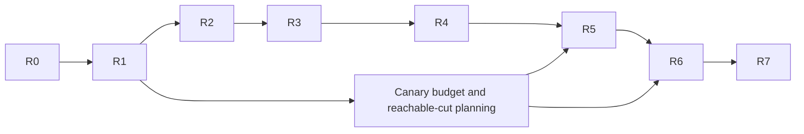

# MAP-ROUTE-1: automatic freight between owned warehouses

## Assignment, adoption and scope

Dispatch: TASKS at `049b02707471b531e3a8d10aabcd46035634128f`, marked
`BEGIN MAP-ROUTE-1` through `END MAP-ROUTE-1`; TASKS blob
`2c27c486033d09ad371384db53b7afd7ba69d081`. The owner rules above that section
require ordinary pushes of this owned task branch at each checkpoint. Never
force or push main. GitLab mirroring remains with the owner/Windows orchestrator;
no SSH trust change or mirror-currency claim is made here.

The clean existing owned checkout creates `task/MAP-ROUTE-1-main` from exact
accepted `e0bb6be7bd26dddd53d2f7e69ae29651fc5c49b9`, without merging moving main.
`task/MAP-EXPAND-1-main` remains published at
`a4617184a6d59772bf6582f67af34417bfe8f116`. Its raw logs, receipts, native/replay
artifacts and bounded failure records stay under `cache/expand1`. Completed ECON
and MAP-INTEGRATE branches and evidence remain intact. The dispatch is read
from the fetched object, not copied over this base's TASKS or STATUS.

Outcome: an authenticated owner assigns a ship an ordered, variable-length list
of owned warehouse stops. Simulation visits perform sailing and cargo actions
without an external per-stop controller. Public suspend/resume/cancel and manual
takeover must be explicit. Two complete productive cycles and a receiving
construction consequence are the original-data canary, not a balanced town.

Salt/deposit work and reserved135 belong to first Mac. Windows owns app/UI,
rendering and W7. No other worktree, branch, job or app source is edited. Foreign
trade/prices, diplomacy, combat, fleet routing, physical collision avoidance,
original-route save import, route editor and general scripting are excluded.

## Compatibility gate before runtime changes

Accepted base is state134 / ECONBK1 / PRNG5 / replay4 / command1 / native wrapper1.
Some chronological state notes still describe predecessor133; accepted headers
and expansion acceptance are authoritative. State136 is reserved for this
route-only package. It does not include salt135. Later combined integration
requires the orchestrator's fresh compatibility decision, not max(135,136).

R1 must review the complete saved schema, field order/widths, rules/digest and
new command tags before C++. Preserve existing command variant order. Candidate
native tags after frozen source's F074 are only proposals until checked/reviewed.
PRNG5 stays: route scheduling draws none; existing movement/other draw ordering
must remain accounted for. No-route worlds preserve behavior/draw order excluding
intentional identity bytes. New136 natives/logs strictly refuse real134 inputs;
no migration, repair or relabelling. No135 refusal is claimed without a real
valid135 artifact. All gameplay defaults remain unchanged.

## Requirement and evidence plan

| Package / requirement | Positive proof | Distinguishing control | Evidence / review |
|---|---|---|---|
| R0 safe adoption | exact accepted base, preserved refs/evidence, host/admission and cheap gate | moving main not merged; no completed voyage rerun | cache/route1/R0; independent review pending |
| R1 original stop contract/reference | actual automatic caller, vtables, fields/units/action/arrival/wrap and interruption paths; independent vectors | request versus target, rounding, action order, zero/partial, duplicate/stale/wrap and interval vectors; malformed/empty CLI refuses | docs/re/ship-trade-routes.md, primary listings ignored; reference/review before runtime |
| R2 data/commands/persistence | typed stable IDs, live authority, full future state, independent nonempty bytes, variable stops and alternate content | corrupt counts/cursors/refs; wrong owner; failed command leaves bytes/money/goods/draws unchanged; actual134 refusal | focused codec/native/state/oracle gates, independent review |
| R3 scheduler execution | matching order+route revision arrival, existing cargo primitives, deterministic bounded cursor progress | arrival bypass and distant transfer fail; smallest/zero/split elapsed and surplus retained; no colocated/refused spin | public command + real scheduler tests, reference parity, review |
| R4 lifecycle/authority | suspend/resume/cancel/reassign/removal, two ships/owners and deterministic shared stock | stale completion/rebuilt target, shortage/full/fractions/holds; six isolated faults fail intended assertions after legal controls | short fixtures/mutation extracts, clean rebuilt binaries, review |
| R5 original automatic freight | unchanged original map/ship/loadout; manual setup labelled; after assign only Advance/observe; two positive cycles, further production, receiving build | inherited cargo cannot count as new export; before-workers no-production arm; public interruption recovery; same build refuses before freight | genuine recording, input/command/hold/tree/goods/all-owner accounts ledger; review |
| R6 continuation/replay/reuse | five reviewed reachable cuts run full suffix; one producer/two fresh children; legal changed command; Release scale and typed consumer card | no artificial halfway transaction; changed command diverges first causal CP after matching prefix; no whole-world cargo scan | native/log/binary hashes, operation counts and timings separately, review |
| R7 frozen finite closeout | focused Debug/ASAN and current real automatic SAN + fresh replay; affected broader shared-seam checks | missing/empty/skip/incomplete/SAN reports stay failures; no stale mutant binary | canonical inventory/raw/receipts + fresh independent integration approval |

Dependency graph:

Each independent approval releases dependent work automatically. Reviewers remain
read-only, derive decisive facts from original bytes/callers, inspect raw outcomes
and do not implement fixes or duplicate long campaigns. An essential unread
predicate blocks only dependent engine work; report its exact trace and required
decision after independent authorized artifacts are finished.

## Existing seams and initial risks

Command ingress is `World::apply` / `Commands::apply`, authenticated issuer and
append-only Body/wire tags. `ShipOrders::move/stop` own current order/ticket IDs,
stop trimming and refusal atomicity. `ShipMover::visit` / `nav_step` produce
order-identified arrival/failure events inside serial figure visits. The figure
registry ring selects visits; crew movement effects merge immediately afterward.
Cargo commands re-resolve explicit warehouse IDs, city/owner/eligibility/range and
configured holds before the common safe transfer plan/commit. They do not scan
all buildings. World field lists, native validation and independent stream oracle
must be updated together if route state is added.

Original `AnnoWelt.dll 0x10055bb0` is the automatic stop, not the manual click.
Existing notes establish only its shared world+0x100 calls and city-at-stop
resolution; they explicitly leave node construction/hold/quantity/stop scheduling
unread. Those are R1 research, not inferred manual behavior. Preserve established
safe cargo arithmetic, authenticated authority and live range validation as
documented adaptations. Exact zero/partial wait/skip policy awaits original trace.

Canary prerequisites: reuse accepted source dock257,134, source Found255,138,
forester238,128, twenty roads and destination dock452,349 / Found456,353 with
height48. Do not repeat site search. Independently budget finite founding wood,
tools and inherited holds before choosing route actions. The first source stock
cut and each productive cycle must close debit=credit and distinguish inherited
hold balance; do not let a positive destination balance alone certify production.
Both cities may be manually founded as setup. Receiving Build1310 occurs only
after the uninterrupted automatic interval, with its same command refused before
sufficient freight. No recipe resource/permission/position edits are authorized.

## Host, work bounds and initial gate

Observed host: Mac17,6 arm64,18 logical CPUs,51539607552 bytes RAM,about1.5TiB free.
Current process/memory snapshots stay in R0 cache; other executors' work is read
only and never stopped. Four build/test slots and memory admission remain enabled.
Long own lanes serialize. Prior E7 raw/artifacts remain frozen; no old voyage is
rerun merely for adoption. New owned build/route-debug, route-asan and route-release
directories may reuse the already pinned doctest source under ignored cache.
No warning exception or coordinator/runner repair is planned.

R0 intended cheap selection: cargo_reference_agrees, integration_stream_reference_agrees,
three ship command byte/refusal/replacement tests and load conservation. Require
the seven existing reference/CLI contracts separately, including the automatic
picture contract; inspect the exact inventory. Preflight25/verdict and workflow
contracts precede compile/test. Initial deadline900s bounds cheap cases, not a
claim about future real auto-voyage execution. R5 pilot keeps the accepted1000ms
partition, ≤2000 advances per sailed leg and ≤400 source-production waits as
initial operator bounds; actual automatic cycle bound and SAN deadline require
measurement and review before the long gate. A deadline never supplies success.
Release measurements use independent active-route/stop/unrelated-world sizes,
raw samples and deterministic work counts; no late-game claim.

R0 cheap gate and independent review are pending. R1 research is in progress.
No runtime route state, behavior, schema or identity change is implemented here.
