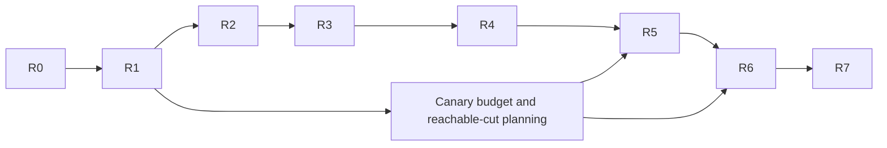

# MAP-ROUTE-1: automatic freight between owned warehouses

## Assignment, adoption and scope

Dispatch: TASKS at `049b02707471b531e3a8d10aabcd46035634128f`, marked
`BEGIN MAP-ROUTE-1` through `END MAP-ROUTE-1`; TASKS blob
`2c27c486033d09ad371384db53b7afd7ba69d081`. The owner rules above that section
require ordinary pushes of this owned task branch at each checkpoint. Never
force or push main. GitLab mirroring remains with the owner/Windows orchestrator;
no SSH trust change or mirror-currency claim is made here.

The clean existing owned checkout creates `task/MAP-ROUTE-1-main` from exact
accepted `e0bb6be7bd26dddd53d2f7e69ae29651fc5c49b9`, without merging moving main.
`task/MAP-EXPAND-1-main` remains published at
`a4617184a6d59772bf6582f67af34417bfe8f116`. Its raw logs, receipts, native/replay
artifacts and bounded failure records stay under `cache/expand1`. Completed ECON
and MAP-INTEGRATE branches and evidence remain intact. The dispatch is read
from the fetched object, not copied over this base's TASKS or STATUS.

Outcome: an authenticated owner assigns a ship an ordered, variable-length list
of owned warehouse stops. Simulation visits perform sailing and cargo actions
without an external per-stop controller. Public suspend/resume/cancel and manual
takeover must be explicit. Two complete productive cycles and a receiving
construction consequence are the original-data canary, not a balanced town.

Salt/deposit work and reserved135 belong to first Mac. Windows owns app/UI,
rendering and W7. No other worktree, branch, job or app source is edited. Foreign
trade/prices, diplomacy, combat, fleet routing, physical collision avoidance,
original-route save import, route editor and general scripting are excluded.

## Compatibility gate before runtime changes

Accepted base is state134 / ECONBK1 / PRNG5 / replay4 / command1 / native wrapper1.
Some chronological state notes still describe predecessor133; accepted headers
and expansion acceptance are authoritative. State136 is reserved for this
route-only package. It does not include salt135. Later combined integration
requires the orchestrator's fresh compatibility decision, not max(135,136).

R1 must review the complete saved schema, field order/widths, rules/digest and
new command tags before C++. Preserve existing command variant order. Candidate
native tags after frozen source's F074 are only proposals until checked/reviewed.
PRNG5 stays: route scheduling draws none; existing movement/other draw ordering
must remain accounted for. No-route worlds preserve behavior/draw order excluding
intentional identity bytes. New136 natives/logs strictly refuse real134 inputs;
no migration, repair or relabelling. No135 refusal is claimed without a real
valid135 artifact. All gameplay defaults remain unchanged.

## Requirement and evidence plan

| Package / requirement | Positive proof | Distinguishing control | Evidence / review |
|---|---|---|---|
| R0 safe adoption | exact accepted base, preserved refs/evidence, host/admission and cheap gate | moving main not merged; no completed voyage rerun | cache/route1/R0; independent review pending |
| R1 original stop contract/reference | actual automatic caller, vtables, fields/units/action/arrival/wrap and interruption paths; independent vectors | request versus target, rounding, action order, zero/partial, duplicate/stale/wrap and interval vectors; malformed/empty CLI refuses | docs/re/ship-trade-routes.md, primary listings ignored; reference/review before runtime |
| R2 data/commands/persistence | typed stable IDs, live authority, full future state, independent nonempty bytes, variable stops and alternate content | corrupt counts/cursors/refs; wrong owner; failed command leaves bytes/money/goods/draws unchanged; actual134 refusal | focused codec/native/state/oracle gates, independent review |
| R3 scheduler execution | matching order+route revision arrival, existing cargo primitives, deterministic bounded cursor progress | arrival bypass and distant transfer fail; smallest/zero/split elapsed and surplus retained; no colocated/refused spin | public command + real scheduler tests, reference parity, review |
| R4 lifecycle/authority | suspend/resume/cancel/reassign/removal, two ships/owners and deterministic shared stock | stale completion/rebuilt target, shortage/full/fractions/holds; six isolated faults fail intended assertions after legal controls | short fixtures/mutation extracts, clean rebuilt binaries, review |
| R5 original automatic freight | unchanged original map/ship/loadout; manual setup labelled; after assign only Advance/observe; two positive cycles, further production, receiving build | inherited cargo cannot count as new export; before-workers no-production arm; public interruption recovery; same build refuses before freight | genuine recording, input/command/hold/tree/goods/all-owner accounts ledger; review |
| R6 continuation/replay/reuse | five reviewed reachable cuts run full suffix; one producer/two fresh children; legal changed command; Release scale and typed consumer card | no artificial halfway transaction; changed command diverges first causal CP after matching prefix; no whole-world cargo scan | native/log/binary hashes, operation counts and timings separately, review |
| R7 frozen finite closeout | focused Debug/ASAN and current real automatic SAN + fresh replay; affected broader shared-seam checks | missing/empty/skip/incomplete/SAN reports stay failures; no stale mutant binary | canonical inventory/raw/receipts + fresh independent integration approval |

Dependency graph:

Each independent approval releases dependent work automatically. Reviewers remain
read-only, derive decisive facts from original bytes/callers, inspect raw outcomes
and do not implement fixes or duplicate long campaigns. An essential unread
predicate blocks only dependent engine work; report its exact trace and required
decision after independent authorized artifacts are finished.

## Existing seams and initial risks

Command ingress is `World::apply` / `Commands::apply`, authenticated issuer and
append-only Body/wire tags. `ShipOrders::move/stop` own current order/ticket IDs,
stop trimming and refusal atomicity. `ShipMover::visit` / `nav_step` produce
order-identified arrival/failure events inside serial figure visits. The figure
registry ring selects visits; crew movement effects merge immediately afterward.
Cargo commands re-resolve explicit warehouse IDs, city/owner/eligibility/range and
configured holds before the common safe transfer plan/commit. They do not scan
all buildings. World field lists, native validation and independent stream oracle
must be updated together if route state is added.

Original `AnnoWelt.dll 0x10055bb0` is the automatic stop, not the manual click.
Existing notes establish only its shared world+0x100 calls and city-at-stop
resolution; they explicitly leave node construction/hold/quantity/stop scheduling
unread. Those are R1 research, not inferred manual behavior. Preserve established
safe cargo arithmetic, authenticated authority and live range validation as
documented adaptations. Exact zero/partial wait/skip policy awaits original trace.

Canary prerequisites: reuse accepted source dock257,134, source Found255,138,
forester238,128, twenty roads and destination dock452,349 / Found456,353 with
height48. Do not repeat site search. Independently budget finite founding wood,
tools and inherited holds before choosing route actions. The first source stock
cut and each productive cycle must close debit=credit and distinguish inherited
hold balance; do not let a positive destination balance alone certify production.
Both cities may be manually founded as setup. Receiving Build1310 occurs only
after the uninterrupted automatic interval, with its same command refused before
sufficient freight. No recipe resource/permission/position edits are authorized.

## Host, work bounds and initial gate

Observed host: Mac17,6 arm64,18 logical CPUs,51539607552 bytes RAM,about1.5TiB free.
Current process/memory snapshots stay in R0 cache; other executors' work is read
only and never stopped. Four build/test slots and memory admission remain enabled.
Long own lanes serialize. Prior E7 raw/artifacts remain frozen; no old voyage is
rerun merely for adoption. New owned build/route-debug, route-asan and route-release
directories may reuse the already pinned doctest source under ignored cache.
No warning exception or coordinator/runner repair is planned.

R0 intended cheap selection: cargo_reference_agrees, integration_stream_reference_agrees,
three ship command byte/refusal/replacement tests and load conservation. Require
the seven existing reference/CLI contracts separately, including the automatic
picture contract; inspect the exact inventory. Preflight25/verdict and workflow
contracts precede compile/test. Initial deadline900s bounds cheap cases, not a
claim about future real auto-voyage execution. R5 pilot keeps the accepted1000ms
partition, ≤2000 advances per sailed leg and ≤400 source-production waits as
initial operator bounds; actual automatic cycle bound and SAN deadline require
measurement and review before the long gate. A deadline never supplies success.
Release measurements use independent active-route/stop/unrelated-world sizes,
raw samples and deterministic work counts; no late-game claim.

R0 APPROVED at ea7da855 by /root/expand_e0_review. Canonical baseline01 passes
6/6 in0.09s; seven required invocations separately1/1; all failed/empty/skipped/
incomplete/sanitizer categories0. Actual472 original files and unchanged manifest
rehashed successfully. RawSHA256
9c99210159ee16321fdd78033cf34a02093a9587684aead84c43ce9da7ccf2df.
Host observations, exact source/binary/inventory/cache identities and input receipt
are retained under cache/route1/R0. Review is retained under cache/route1/reviews.
R1 original research/contract/reference is released; runtime remains gated on its
independent approval.
No runtime route state, behavior, schema or identity change is implemented here.

## R1 execution contract — review candidate, before C++

Primary predicates, original group/order/quantity and nominal delay are in
[the original research](../re/ship-trade-routes.md). ORIGINAL below means those
instructions/data; ADAPTATION means this authenticated, stable-ID headless model.
No claim includes the original editor, import, float timing or physical collision.

### Definition, normalization, public control and authority

Append two Body alternatives, preserving all twelve existing alternatives:
`AssignFreightRouteCmd` then `ControlFreightRouteCmd`. Reserve currently unused
native tags F075 and F076 respectively. Wire version1 stays because native136
and replay4's explicit state/schema identity reject earlier peers before their
commands execute; new native tags cannot be encoded as LegacyRawCmd.

Public assignment: ship FigureId plus an ordered vector of stops. Each stop has
stable warehouse BuildingId, exact i32 Q24.8 dock point x/y and ordered actions.
An action is `{direction u8:0LoadTarget/1UnloadAmount, goods u32, tons u64}`.
Goods/warehouse roles use the existing registry/CargoRules, not canary IDs.
Load tons is the desired total aboard of this goods; Unload tons is the amount
to remove. Each amount and checked sum must fit u64 raw (tons≤U64_MAX/256).
Zero is a legal no-effect action, including its delay. Stops may have no actions.

Normalize a stop once at assignment in O(actions log distinct-keys): for each
`(direction,goods)` combine all amounts into its first occurrence and replace
later occurrences' amounts by zero. Preserve every action's position, direction
and goods, so every entry still incurs its delay. This reproduces the kind10
block grouping and first-occurrence effect without a per-tick quadratic scan.
Every typed stop represents a separate movement/action block, including repeated
warehouses; no grouping crosses stops. Query returns this idempotent canonical
definition; the command recording retains the input definition. Native load
requires canonical duplicate entries to have zero quantities.

Validation before any write: known authenticated issuer; figure exists, is owned,
is a navigating eligible cargo ship with no parent and no blocked navigation
state; nonempty stop list within configured stop/total-action limits; all dock
points inside the world; all action kinds/quantities/goods valid; every named
warehouse exists, is eligible and belongs to issuer; generation increment fits.
Input byte counts and sums are checked before allocation/arithmetic. Stop range
is an execution-time requirement, not a demand that a distant assigner already
be docked. No validation searches for a replacement or nearer warehouse.
Failed assignment/control leaves all native bytes, money, goods and draws intact.

Assignment increments a per-figure u64 generation, stops its current navigation
through the existing stop primitive and installs the new definition at stop0.
The generation survives cancellation. A replacement never reuses an old pending
order identity. Exhausted generation refuses SerialExhausted atomically.

Control body: owned ship plus enum Suspend0, Resume1, Cancel2. Suspend freezes
the current wait/work cursor, drops a pending navigation order through normal
stop semantics and records that the same leg must be reissued. Resume resets
the service clock to now (paused time never catches up), clears a recoverable
failure and retries the preserved stage or reissues the interrupted leg. Cancel
stops navigation and removes assignment while preserving the generation counter.
Unknown route/control enum/state gives a typed refusal. Resume revalidates live
ship/target authority; it does not repair a missing stable warehouse reference.

ADAPTATION: successful manual Move, Stop, Found, Load or Unload takes over that
ship and removes its automatic assignment. Existing manual cargo semantics stay
otherwise unchanged: a transfer does not additionally stop an in-flight segment;
any remaining order becomes ordinary manual motion until Move/Stop replaces it.
Failed manual commands do not cancel anything. Internal automatic cargo/movement
calls the existing primitives directly, not this manual takeover ingress.
This also prevents a saved in-progress hold scan from surviving a manual mutation
of the ship's holds. Original manual cargo did not itself cancel automation;
this explicit takeover policy is modern control ownership, not original parity.

Control outcomes (after known-owned-navigating-ship checks):

| Current state | Suspend | Resume | Cancel |
|---|---|---|---|
| No assignment | BadValue, unchanged | BadValue, unchanged | success, unchanged; do not stop unrelated manual motion |
| Running | accrue active stop-clock credit, freeze; Sailing becomes NeedLeg and pending token clears | idempotent success, no clock reset | normal stop and remove definition |
| Suspended | idempotent success, no additional clock credit | revalidate, preserve cursor/credit, set last_tick=now; interrupted leg is NeedLeg | normal stop and remove definition |
| Failed | idempotent success, already stopped; retain failure | revalidate then retry exact preserved non-navigation stage; failed leg is NeedLeg | normal stop and remove definition |

Suspend/Cancel remain usable on a navigation-blocked ship. They reuse trusted
stop operations after ownership/nav validation; Resume/Assign still refuse a
blocked ship. If the live target remains invalid, Resume refuses without changing
the paused/failed record. Clear the old reason only after accepted Resume.
Counter exhaustion at CompleteStop retries no cargo; Cancel/Reassign can replace
that route. A rebuilt warehouse requires explicit reassignment to its new ID.

For Wait/Scan/Transfer/CompleteStop, first Suspend accrues checked `now-last_tick`
into saved credit WITHOUT automatic actions, then stamps now and pauses. Failed
action validation likewise retains already accrued active credit. Repeated
Suspend and running Resume are true state/clock no-ops. Resume preserves credit
but stamps now, excluding paused time. NeedLeg/Sailing have no stop-wait credit;
unvisited motion follows existing Stop semantics without retroactive integration.
Failed navigation canonicalizes to NeedLeg and clears both pending order fields.
Other failures preserve their exact Wait/Scan/Transfer/CompleteStop progress.

Same-tick ordering is the existing serial ingress: run_turn applies authenticated
commands in recorded order BEFORE advance. Successful takeover/reassignment wins
before the figure visit. Commands applied after advance cannot undo a committed
transfer. Existing AI/seam commands obey their actual serial scheduler position.
There is no public interleave between transfer commit and cursor advancement.
The reference distinguishes failed manual input from successful takeover, and
stale failure from matching failure. NeedLeg issuance is an explicit visit event,
not a hidden Move at assignment acceptance.

### Visits, time, transfers and progress

The figure registry retains its existing serial visit order. A ship with no
route follows exactly its existing mover. Route work is additional only for an
assigned visited ship. Existing ShipMover navigation, planning quotas, arrival
events, crew merge and PRNG behavior are reused; no background controller or
additional random draw is introduced.

Phases: NeedLeg→Sailing→Wait→Scan→Transfer→(next action Wait or CompleteStop)→
NeedLeg. Status Running/Suspended/Failed is separate from the progress phase.
NeedLeg validates the stable target and issues existing Move to the explicit
dock. Transfer is forbidden until the same ship's current generation AND expected
order ID produce ShipArrived. A route failure stops recoverably; duplicate/stale
arrival/failure cannot advance or transfer. Each action revalidates live target,
owner, role and BOTH cargo range predicates. Arrival alone never grants range.

ADAPTATION: accepted modern ShipArrived is observed at a simulation visit stamp.
The first wait starts there with zero credit; no original sub-visit arrival or
float surplus is reconstructed. Each later visit adds actual elapsed integer
ticks to checked saved credit. Wait uses existing FigureType.load_ticks (500 for
original1502) and spends only available credit. Delay0 expires without waiting;
zero elapsed contributes zero. Wait surplus flows through subsequent actions
and their waits at this SAME stop, including normalized duplicate zero entries.
Unspent credit and partial wait survive deterministic work quotas and native load.
Already-started instantaneous work may resume at zero elapsed; a positive delay
never expires without credited time. Suspended/failed time is never credited.

Issuing the next Move is an explicit forward-only deferred movement boundary:
the next leg begins at current clock time, as with accepted Move commands. End
the old stop's wait credit there. Do not backdate sailing or carry that old
credit into a future destination's wait. This is deliberately different from
original428d0's fractional movement→wait→next-node loop. Isolated delay tests
cover500 versus499+1, zero, two waits with surplus, quota continuation and this
new-Move boundary. No whole-world advance-partition invariance is claimed.

After each action's wait, Scan visits the first min(hold_count_a,holds.size())
hold indices with one deterministic work unit each. It records the matching
raw total and candidate index vectors: matching (nonfull for load, all for
unload), then empty for load, each ascending. Checked sum overflow fails before
cargo. Loading remaining=max(0,normalized_tons*256−matching_total); unloading
remaining=normalized_tons*256. Candidate state is saved, not a pointer/stock plan.

For each candidate form request_tons=floor(min(remaining,selected-room-or-held)/256)
using wide checked integers. Zero request ends this action, including a first
fractional candidate that blocks a later empty hold (ORIGINAL caller rule).
Otherwise call accepted ShipCargo::load/unload, using this candidate as the
preferred/named hold and the stable warehouse. Loading may redirect according
to the shared resolver; it is not a second arithmetic/hold-selection path.
ADAPTATION: cap a per-call request at U32_MAX tons before converting to the
existing command's width. This cannot reduce an actual unload because city free
space is at most U32_MAX RAW units; load is already bounded by u32 hold capacity.
Never narrow a u64 grouped request by wrapping it. A wide-target fixture pins this.
Only the first min(hold_count_a,holds.size()) entries count or receive a transfer;
extra/B holds do not participate. Repeated load fallback queries may use a DERIVED
local hold-selection index with exact parity to the shared preferred/maximum-
room-lowest-tie/first-empty rule. Build it incrementally during Scan and rebuild
on native load, outside the hot path. A narrow resolved-hold entry to the SAME
live validation/transfer commit may avoid a repeated linear resolver for every
hold; public manual behavior and failure order require parity controls. This
index is not authoritative serialized state and cannot authorize any transfer.
Actual transfer reduces remaining. Advance the saved candidate cursor exactly
once with that committed effect before another visit can run. All fallible
validation precedes stock writes in the shared primitive.

Resource refusals (short stock, full store/holds, mismatched/empty candidate) or
zero actual quantity end the action and continue after the next action's wait;
partial positive transfer continues to the next prepared candidate if any.
No wait-until-full/retry-until-stock behavior is invented. Structural, ownership,
range, disabled-ship and navigation errors enter recoverable Failed with the
original reason; they never silently retarget. Resume/reassignment is public.
The original shared arithmetic's destruction/wrap quirks stay replaced by the
accepted safe conservation rules.

CompleteStop advances the stop cursor and wraps; completed_cycles counts route
wraps, including unproductive ones. It does NOT certify newly produced/delivered
goods. Transfer observations must have positive actual quantities to prove cargo;
the integration ledger must additionally establish production provenance.
Counter exhaustion fails without wrapping or repeating a committed transfer.
At most work_per_visit primitive steps execute: one phase transition, scanned
hold, candidate transfer or stop completion per unit. Colocated/zero/refused
definitions therefore cannot busy-loop. Existing navigation query budgets remain.

### Frozen schema proposal and compatibility tests

New rules appended after Rules.city_booking: `FreightRules` with three u32 fields
`max_stops=1024, max_actions=2048, work_per_visit=64`. Limits bound hostile public
definitions and per-visit continuation, not the two-stop recipe; they are config
and part of the rules digest. Defaults fit the existing u16 ClientRecord payload
(head12 +1024*20 +2048*13=47116 bytes). Larger configured definitions still must
fit that existing framing; changing framing is a separate future decision.

Append to Figure AFTER resident: u64 freight_generation(default0), optional
FreightState (presence byte). No existing field/variant order changes. New present
state fields in this exact order:

| Field | Width / encoding |
|---|---|
| stops | u64 count; each warehouse u64,dockx i32,docky i32,actions countu64; each directionu8,goodsu32,canonical_tonsu64 |
| status,phase | u8 each; Running0/Suspended1/Failed2; NeedLeg0/Sailing1/Wait2/Scan3/Transfer4/CompleteStop5 |
| stop_index,action_index | u32 each |
| expected_order_id,order_generation | u64 each; zero except current Sailing; both match live assignment/order |
| last_tick,credit_ticks | u64 each; last≤world tick,credit≤last, overflow checked |
| wait_remaining | u32, partial integer duration |
| scan_next | u32, scanned hold prefix length |
| matching_raw,remaining_raw | u64 each, checked |
| matching_holds,empty_holds | u64 count then u32 indices, ascending/disjoint/in-domain |
| candidate_next | u32 over matching then empty candidate vectors |
| completed_cycles | u64, never wraps |
| last_reject,nav_failure | u16 existing Reject value, u8 existing NavFailReason value |

Native validation rejects enum/count/arithmetic/cursor/clock impossibilities,
noncanonical quantities and mismatched pending order/generation. A missing target
after legitimate demolition is a valid pending/Failed definition, not a repaired
reference: native load cannot require every future target still to exist.
Prepared candidates must be valid hold indices and match the stage's invariants;
no serialized city/building/figure pointer or derived whole-world index is added.
Native readers bound stop/action counts by the existing ClientRecord framing's
maximum representable counts BEFORE allocation, and candidate vectors by the
already-read hold count. World rule limits then validate the complete state.
This prevents a short hostile count from amplifying allocations; those absolute
limits follow the unchanged u16 framing, not a hidden two-stop engine maximum.
Suspended Sailing becomes NeedLeg on stop so it owns no phantom navigation order.

F075 wire payload: u64 ship,u32 stop_count; each stop warehouseu64,dockxi32,
dockyi32,u32 action_count; actions directionu8,goodsu32,tonsu64. F076 payload:
u64 ship,u8 control. Exact-length framing, unknown enum, hostile/truncated counts,
trailing bytes, zero-stop and overflow vectors must refuse before state mutation.
New public observations carry ship/generation/order/stop/action/warehouse/goods,
actual direction/quantity and reason for pending/arrived/transferred/skipped/
paused/failed/cycle events. Observations are host output, never control authority.
Only the fields above affect future simulation and must be explicitly serialized.

State136 / ECONBK1 / PRNG5 / replay4 / command1 / wrapper1 is route-only, with no
salt135. Preserve actual134 artifacts and validate them with the pinned old
reader before new refusal tests. New136 rejects134 native and replay identities,
and independent nested replay/native mismatches. No135 check without a real
artifact. Independent stream reference and hand-written present route bytes must
cover every nonempty progress field, not just absence/default encoding.
No-route old semantic fields/draws must match134 after projecting out explicit
new rules/empty-generation/absence bytes and identity, with each changed scope
explained. Old134 fixtures remain unchanged; new136 fixtures get honest producer
provenance and independent schema expectations. No silent historical rewrites.

### Real canary cut and finite starting budget

The R5 pilot will preserve original cargo, positions and map. Proposed legal
setup: accepted source founding/tools/801/20roads and first448raw receipt, but no
manual source wood Load. Publicly switch production off after that receipt, sail
to destination, found/unload1t tools and show1310 CannotAfford, then manually
return to source. This pause bounds already-made wood while making both cities.
Resume production publicly BEFORE assignment. Hold0 retains26t inherited wood;
source contains only produced wood, expected total630raw before resumed output.
Assign source LoadTarget28t / destination UnloadAmount2t, allowing actual positive
source2t to fund each2t delivery while the26t baseline remains aboard.

At first automatic load record all previously made wood (warehouse, producer out,
active carts; no double-counted reservation/raw). Require that remaining made
pipeline is strictly below the second512raw export, and that further genuine
production supplies the deficit. Confirm this feasible cut with one bounded
pilot before the long campaign. After assignment only Advance/observe until two
positive source-load/destination-unload cycles; no per-stop external commands.
Then issue the same receiving Build1310, costing50g/1wood/1tool. Total normal
construction remains1000g,24t inherited founding wood,13t inherited tools and1t
produced receiving wood; all upkeep and holds are measured, not prewritten.

No-production control begins before workers/raw/output, uses public Off and never
reenables production. Under the original skip-on-zero policy it may still unload
inherited cargo; a wrap or receiving stock alone must therefore NOT certify
productive freight. It must have zero source wood export/new production and zero
qualified productive cycles. Main proof requires matching positive source debits,
destination credits, unchanged inherited hold baseline and complete goods ledger.
This explicitly challenges the inherited-cargo false positive instead of adding
an unsupported wait-until-full rule. A separate public suspend/resume branch and
five reviewed reachable save cuts supplement the uninterrupted interval.

### R1 independent-reference evidence, before runtime

`tools/freight_ref.py` computes grouped target/request transfers with caller
quantization/shared safe resolver, isolated wait/surplus/work-quota transitions,
generation/order lifecycle and independent native/wire bytes. The40 synthetic
JSONL answers are hand-derived; the implementation never reads expect to compute
an answer. This is a transition/transfer/schema oracle, not a navigation oracle
or runtime controller. Actual path/authority/range validation stays with public
C++ scheduler tests. Native byte vectors separately cover a pending sailing order
and a suspended partial candidate cursor; absence retains generation in9bytes.

First direct reference check correctly rejected an incorrectly hand-written
absence literal with an extra zero byte. The nine-byte generation+presence
answer was corrected; first failure remains R1/reference-first-check.log,
superseding focusedcheck02 and selftest pass. The public CLI contract executes
23 positive/negative probes, including changed legal input, wrong expectation,
empty/truncated/malformed/duplicate input, booleans/floats/out-of-domain amounts,
quantity sum overflow and missing file/unknown command. Canonical R1 reference
gate and complete independent primary/schema review are still pending.

R1 focused refinements before C++: wide per-call request caps at U32_MAX without
changing an actual u32-capacity store transfer. The partial native byte witness
now uses LoadTarget5t=1280raw, initial matching256raw (hold0=256,hold2=0 with the
same goods,hold1 empty), capacity1024 and source512. First candidate requests
3t from room768 but available stock512 yields actual512; remaining is512, current
hold0 is768, candidate_next1 and matching_raw256. This is a reachable partial
effect, not target3t below a claimed1024 already aboard. A separate wait witness
has321ticks remaining and zero credit, independently covering the partial-delay
field. That35-vector refinement passed directcheck/CLI23; the later40-vector source
requires canonical02.
Canonical01 at731d8c98 passed1/1 plus eight separate required invocations and
zero other categories; it remains evidence for its original33-vector source.

R1 review refinements now also define the full control table, Failed-stage
canonicalization, same-tick ingress and pre-suspend active-credit policy. The
reference has40 hand-derived vectors: cargo explicitly names hold_count_a and
ignores extra/B holds; lifecycle has deferred NeedLeg visit issuance, matching/
stale failure, repeated controls, failed-manual no-op and successful takeover.
Control-clock vectors accrue50 active ticks atSuspend150, exclude paused time
throughResume1000, then finish at1350; repeated Suspend/running Resume do not
reset the service clock. An already partly spent wait CAN carry positive credit
after Suspend accrual/Resume; native validation must not forbid that legal state.
Firstcheck's extra absent-byte literal, initial partial-witness mismatch and the
wide per-call/prefix/control refinements remain documented rather than relabelled.

Logical optional FreightState may use a route-specific owning deep-copy slot,
so unrelated actors pay only an empty pointer/counter, not an inline route-vector
buffer. No pointer is serialized or used to identify targets, and World copies
must own independent mutable progress. This is an in-memory representation only;
the reviewed generation+presence+present-state bytes above do not change. Derived
hold indexes likewise never enter the saved schema; native load rebuilds them.

Actual accepted134 G2 native was extracted UNMODIFIED from current134/g2.log into
fixtures/synthetic/sim/freight/legacy134/g2.save,115278bytes, SHA256
aad758490b57f78e06a895f90a1e9384ef87b4c55ce614130dd376cdabe33a37.
Its pinned old134 CLI reader reproduces6/6 checkpoints at tick20000. Provenance
and old-reader hash are retained; this is a valid old-refusal control, never a
136 schema oracle. No135 compatibility proof is fabricated.

R1 APPROVED at cc440c5150376fe5fda2d5230a2c06d423d447bd by
/root/expand_e2_review, independently inspecting original module bytes/vtables,
caller boundaries, quantities, integer timing adaptation, the full schema and
hand answers. Canonical02:1/1 selected,40 vectors; eight prerequisites separately
1/1; CLI23 probes; failed/empty/skipped/incomplete/sanitizer0. Raw SHA256
 e7110b9610415cbcc82505ef43264965317f1b8d46c22ee913bdfd922f005e21.
R2 is released. Assignment/Resume additionally require a live (not expiry-list)
actor; Suspend/Cancel may clean up an ended/blocked assignment. R3/R4 must clear
route state at ship end/removal without making a legitimate native cut invalid.

### R2 acceptance before runtime implementation

| Requirement | Positive proof | Counterexample | Review |
|---|---|---|---|
| Public assignment/control | authenticated variable stops, canonical grouping/query, alternate goods/warehouse, deep-copy snapshots | unknown/foreign/dead/blocked/parent ship; bad quantities/targets/counts; byte-identical refusal | pending |
| Complete saved schema | hand-written pending/partial/wait/cancel suffixes and rules bytes; native roundtrip | malformed counts/enums/cursors/clocks/order revision and canonical duplicates | pending |
| Identity and no-route behavior | independent136 scopes/goldens, old-field projection versus134, unchanged draws | real134 native/replay and nested identity refusal; old fixtures untouched | pending |
| Existing command compatibility | append-only tags/variant and manual takeover only after success | failed manual input retains route; unknown native tags cannot hide as legacy | pending |

R2 does not connect automatic visits until independent approval. No original
content role, default gameplay switch or random timeline changes are released.

R2 implementation candidate: public assignment/control/query, per-actor deep-copy
optional storage, checked grouping/authority/clock controls, successful manual
takeover and end cleanup, reviewed explicit136 field list and native validation.
Shared read-only cargo destination validation preserves existing manual refusal
order; assignment alone omits range, not actual transfers. Six independent
wire/native literal cases agree; all25 nested future-field changes affect the
hash and roundtrip. Four direct public cases pass after correcting test diagnostic
and replay-start mistakes (first failure retained). They are not acceptance yet.

Twenty actual producer cases generated a new136 family/41 current goldens in
64.66s. Independent no-route world/scopes/rules agree. Old/new actual G2 projection
matches all old fields at entries0/100/200/421, including identical clock_rng and
all other scopes, excluding only reviewed header/absent route bytes. Original134
files and old reader are unchanged. Generation is separate from canonical R2
acceptance and independent review, both pending. No scheduler automation yet.

R2 APPROVED at f1dbf9106b41b918da359647c4a8ba7ade2238d9 by
/root/expand_e0_review; runtime/schema e1a1ddb1 unchanged by focused test fixes.
Canonical01 remains FAIL:selected106/executed103/failed3, all other categories0.
Three old native-tag/member assumptions were corrected. Canonical02 PASS32/32
(0.48s), eight prerequisites separately1/1, all other categories0. The103 unchanged
prior passes are explicitly reused; no false106/106 claim. Receipt freezes actual
source, binaries, inventory, configuration and rawSHA
42ab6ed1aef9739b75d67cdefff42c35c7934e740fabc052881fb7edfeaabffa.

Reviewer-requested focused controls cover full World reload of prepared Sailing,
Wait, Scan and partial Transfer; intended corruption refusals; pre-Suspend active
credit; repeated controls/running Resume no-op; paused-time exclusion; blocked
cleanup/missing stable target refusal; accepted/refused manual Move/cargo/Stop.
These are prepared schema fixtures, not yet R3/R6 reachable public cuts. No
blocking R2 finding remains. R3 execution is released without an owner pause.

### R3 acceptance before integration

| Requirement | Positive proof | Wrong interpretation / control | Review |
|---|---|---|---|
| Real visits | public assignment issues deferred Move and matching arrival starts wait; real cargo effects | stale/bypassed arrival or distant dock cannot transfer | pending |
| Clock/continuation | smallest/zero/split/surplus waits, quota continuation, native suffix | positive wait expires without credit; saved cursor repeats debit | pending |
| Shared safe primitives | exact hand-derived target/group/rounding/partial quantities | additive request, rounded stock, wrong fallback hold, no A-prefix | pending |
| Work and no-route reuse | bounded primitive work, route-local hold index, unchanged unassigned mover | colocated/refused spin; repeated whole-world/hold fallback scan | pending |

R3 candidate integrates assigned ships inside the existing serial figure ring.
The accepted mover runs once per visit; only its local matching order/generation
arrival starts the first500tick wait at that visit stamp. Work quotas continue
Scan/Transfer/action/stop state; Move is issued at now and sails on a later visit.
Manual ingress and notifications cannot inject an arrival. Actions recheck the
live stable warehouse/owner and both cargo range predicates. Structural errors
stop recoverably; resource zero/partial follows the reviewed advancement policy.

The route slot's active heap also owns a DERIVED hold index, with inverse-room/
index ordering and first-empty set. Unrelated figures retain one empty pointer.
The index is built during saved-prefix Scan, updated after transfers, copied by
value and rebuilt from current holds during native load, outside visits. It is
not serialized or authority. All reviewed136 bytes remain unchanged. Internal
resolved loading enters the SAME validation/plan/commit as manual Load; manual
calls keep their original resolver/failure order. Cargo result allocation occurs
before stock writes, so the canonical cursor can advance immediately after the
shared commit. Host observations and work counters are not saved/hash state.

Direct R3 controls pass19 pre-C++ cargo vectors through actual visits, two actual
automatic synthetic deliveries, distant-warehouse range refusal, one reachable
partial-effect full native suffix, zero/1ms/2ms/499+1 waits,1250tick surplus across
two waits with8step quotas/native continuation, and deferred Move credit reset.
Same-tick run_turn cancel/reassign wins before due cargo; a refused manual Move
preserves it; cancel after advance cannot undo a commit. Colocated/no-cargo input
stays within configured work. Canonical acceptance/review are pending.

Preserved direct failures exposed a SYNTHETIC boundary dock whose accepted mover
arrived one tile outside cargo range, and unrelated fixture market carts changing
the figure ring during an isolated clock check. The synthetic dock now has range
margin; its registry disables cart spawning for the isolated route-only fixture.
No engine range/visit rule, original canary position/resource, or wait was relaxed.
The existing mover's idle/pickup delay is observed, not bypassed. R3 reference/caller
claims remain isolated transitions, not whole-world partition invariance.

R3 independent review at99d34ad7 found two hidden costs despite the preserved
canonical115/115 plus eight separate contract passes: target validation walked
all actions each visit, and resetting node sets destroyed O(H) entries in one
quota unit. Both are corrected before package approval. Runtime target checks
now inspect only live warehouse/owner/range and current goods; full definitions
remain assignment/native validation. Newly selected NeedLeg stops are checked
inside the quota loop before Move, without duplicating the initial check.

The derived resolver now uses a mutable inverse-room/index binary heap, direct
hold-position buffer and ascending initial-empty buffer/cursor. Trivial raw
buffers reserve at logical size0, each initialized hold is charged to scan_next,
updates are O(logH), and action reset retains capacities without per-node walks.
Snapshot copies preserve capacities; cold native load reserves/rebuilds outside
visits. Current empty fills increment the cursor immediately, without a pruning
scan. Canonical candidate buffers have the same bounded initialization policy.
This changes no authoritative136 byte/field/clock/PRNG semantics. New focused
controls hand-check fractional max-room ties (256,256,44 raw) and full suffix
continuation of a public129-hold partial Scan across copy/native reload. Existing
navigation's hold-speed-factor work is unchanged and remains a separate cost.

R3 APPROVED at92264de4fc0dfa79d77d474fe4a01a6a45caa177 by
/root/expand_e2_review. Canonical02 PASS18/18 (1.97s) plus eight separate required
contracts, all other categories0; rawSHA
68aa9d7011003320b546e293c45db5132703fe04e284939cb3d4b25c3a6e17d6.
The original115/115 at99d34ad7 remains preserved, with unchanged manual/non-route
dependencies explicitly reused. Both hidden-cost findings were fixed/re-reviewed;
all seven receipt hashes and the actual old/new no-route field projection were
independently reconciled. R4 is released. Real original freight, five final public
cuts, fresh replay/scale and current sanitizer/final acceptance remain open.

### R4 acceptance before adversarial work

| Requirement | Positive proof | Counterexample | Review |
|---|---|---|---|
| Control lifecycle | public suspend/resume/cancel/reassign at sailing/wait/action/partial; no repeated effect | stale notification/order cannot advance replacement; failed control unchanged | pending |
| Authority/live targets | two owners/ships, explicit stable warehouse, owner-local conservation | closer rival/other owned city, demolished/rebuilt target, shared visibility grants no cargo authority | pending |
| Failure/end recovery | public retry/reassign/cancel, ended/removed ship releases route | unreachable/blocked/range/short/full/fractions/counter limits | pending |
| Causal faults | legal baseline then six precise faults fail intended assertions | arrival bypass, wrong warehouse, credit-only, duplicate action, stale revision, lost native cursor | pending |

Fault attempts retain their individual logs and source substitutions. Restore the
exact clean source and rebuild before any acceptance gate; no mutant executable
may supply later evidence. These are short synthetic controls, never six reruns
of the real voyage. No original stocks, flags or positions are repaired.

### R4 reviewed checkpoint

Independent `/root/expand_e0_review` approved clean runtime/test source
`2a82870e5af5b29ea55d5a3539e490e87c6ca0f1`. All four R4 acceptance rows above
are approved for their bounded synthetic scope: public interruptions at actual
arrival/action/partial boundaries, exact city/hold/goods/owner ledgers, stale
order and generation authority, stable rebuilt destination identities and ended
ship cleanup. Six precise fault controls each pass their legal case then fail
the intended assertion; no crash or unrelated refusal supplies the failure.

Canonical `cache/route1/R4/canonical-debug-01.log`:31 selected/31 executed, eight
required contracts separately, all other outcome categories zero,2.18s. RawSHA
`cece2a472b7aa272a877355a38472116e40533ebba110563f8448af918ebb11b`.
Original binary/config/inventory hashes are frozen in `debug-receipt-01.json`.
The first mutation campaign lacked individual executable hashes; its logs remain
untouched. The supplemental short `faults02` campaign records each legal/mutant
binary, source and patch hash. Exact source restoration, clean economy_checks
rebuild and27/27 legal cases are bound by `faults02/restoration.json`. Later
relinking changes executable bytes; it does not relabel the original gate.

Earlier investigative failures are retained: a fixed navigation-pickup interval
assumption was replaced with the actual matching-event invariant; ordinary Build
of original harbour1302 is unsupported, so lawful reconstruction uses a clearly
synthetic eligible land-warehouse type70001 and unchanged public costs. Neither
original canary positions/resources nor gameplay rules were altered. Reviewer
independently checked primary caller/order seams, hand-derived quantities, raw
failures and restoration hashes; note `cache/route1/reviews/r4.md`.

R5 is released. R1 reviewer `/root/expand_e2_review` agreed five proposed public
canary cuts (actual source-leg Sailing, source arrival Wait, loaded outbound,
destination arrival Wait, return after first delivery) and independently derived
the1000g/26↔28t ledger. Planning agreement is not R5/R6 acceptance; actual pilot
reachability, new-production provenance and full suffixes remain pending.
Route-only136 stays based134 with no salt135; no defaults changed.

### Portable MAIN-CI-1 intake checkpoint

Read main board/report at96775da4; no merge. Separately adapted the15 applicable
portable files from repair-only d1a2e191..92e4817b atbba78fce: checked local script
transaction targets, portable test includes/references/null checks, final-location
nonmovable farm statistics fixtures, truthful script/economy consumer prerequisites
and metadata-only port0 isolation. No conflict resolution, gameplay/default/schema
change, salt135 or app/Windows intake. Omits main134 economy fixture/path and board.

Independent `/root/expand_e2_review` approved clean052d7143. Gate01:99selected,
98executed passes,1failed stale134 header literal, five required separately.
Gate02 retains a diagnostic-string assertion mistake in the new134 refusal check.
Gate03 at052d7143:1/1 header case plus two required separately, all other0.
The corrected16 hand bytes are136u32/ECONBK1u64/PRNG5u32; old134 explicitly fails.
Only that test changed after the98passes, reused with this dependency; no99/99
single-run claim. Raw logs and pre-rebuild hashes remain in
`cache/route1/ci-intake/receipt-0{1,2,3}.json`; review in `reviews/ci-intake.md`.

Historical root economy-loop checkpoint pins still say133 and are not valid136
expectations. No full original economy-loop acceptance is claimed by this intake.
Any later affected full economy loop requires independently attributed136 pins,
preserving133/134; copying main134 expectations is excluded. R5 current136 city/
money proof remains independent of that historical canary.

### R5 acceptance before the unchanged-original pilot

| Requirement | Positive proof | Counterexample | Review |
|---|---|---|---|
| Genuine automatic freight | original manifest/loadout/sites; public source/destination founding and forester20roads; after Assign only Advance/observe through two positive768raw exports/receipts | inherited26t hold baseline is retained, first-load totalmade<1024 requires later new production | pending |
| Complete ledgers | every advance closes tree/raw/farm/cart/source/export and all city/hold goods; all-owner money, city bills and zero income/trade/billed terms | no unexplained goods or money residual; same1310 Build refuses before and succeeds after | pending |
| Controls | pre-workers world publicly Off forever; same bounded setup/route suffix yields zero source export/new production; inherited deliveries explicitly unqualified | separate real loaded-sailing Suspend/Resume/Cancel branch, no main interval commands | pending |
| Reachable continuations | five R1-reviewed actual public cuts, each full remaining Advance/command/events/draws/actor/city/native suffix | no artificial partial transaction, source initial leg labelled possibly degenerate | pending R6 |

Pilot bound is6000 automatic1000ms advances (each full figure/city-ring visit),
400 first-production waits and existing2000 per manually sailed leg, with no
search or gameplay/resource change. This is a finite failing work bound, not an
engine limit or a success condition. Debug pilot timeout900s is declared before
execution using prior original expansion measurements; final SAN bound will be
declared from the measured pilot and known SAN ratio. Pilot artifacts live in
a new ignored directory, never overwriting accepted expansion evidence.

#### R5 measured prerequisite correction (supersedes proposed2t recipe)

Pilot01 at46001a06 failed an oracle scope error: all five owners' cargo was
summed against Human-only starting totals. e3f0ee35 derives pristine per-owner/
goods totals, closes each owner's deltas, asserts militarycost0 and source civil
history27→19→27. Pilot02 then faithfully loaded256raw from448stock, failing the
planned512 first load. Partial/skip semantics remain unchanged; both failed
canonical logs and pre-rebuild receipts are retained.

Saved-source-arrival short public Cancel/Advance probe disproved the assumed
2t/P<1024 prerequisite: the next collection occurs at237500 with952stock,168out,
zero active cart, P1120. A second short public Assign probe proved an actual
768raw first load at239000 with unchanged P1120 and29t aboard. Each probe binds
source/binary hashes, restores exact source and rebuilds; these investigative
controls are not full-voyage acceptance. Raw evidence `R5/probe02`, `R5/probe03`.

Reviewer `/root/expand_e2_review` independently checked the trace and revised
operator arithmetic: after public On, bounded Advance/observe setup waits for
768warehouse wood (60advance cap measured from the39advance prerequisite); route
source LoadTarget29t/destination Unload3t preserves26t inherited cargo, and
first-loadP<1536 makes the second768export require further production. Two
receipts1536 minus256receiver sink leave1280raw destination stock. Normal1000g
construction,13t tools and original food/sites/loadout are unchanged. No rule,
resource, position, permission or identity change authorizes this recipe.
The current R5 positive/control/table quantities use768/1536/29t; earlier2t
proposal/failed evidence remains historical. Full revised canary is pending.

### R5 reviewed unchanged-original automatic freight

Independent `/root/expand_e2_review` APPROVE at tested
`007d595e3f3841824548a859b70d89843a0fc66c`; only current acceptance-table512→768
wording changed after the gate. Canonical03:1selected/1executed pass,69742
assertions, five required contracts separately, all other categories0,162.47s.
RawSHA `13b6d86c1e1a9ad16357062ac0143d3a779eb9f4d4b531644e5151fea04111f2`.
All18 source/config/binary/log/artifact hashes frozen in R5/receipt-03.json;
472 original input bytes plus manifest rehashed after execution, unchanged.

Actual first collection39 setup advances;290 subsequent automatic advances.
Source loads768 at239000 and334500, destination receives768 at287000 and382500.
First end-load made1120 minus768 leaves352made wood, so the second768 export
requires at least416 NEW MADE WOOD (Q8 units), not raw BAUM input. Per-advance
nonnegative source/raw/farm/cart ledgers prove this causal deficit. Final3892
made =1536export+2048source+308farmout, active woodcart0.36cuts credit9216raw
BAUM=8896consumed+320farmraw, observed growth9; no raw/cart loss.

Two foundings/801/20roads/1310 cost1000g,24t inherited founding wood plus1t
produced receiver wood and13t tools. Human hold order26wood/10food/37tools/30tools;
destination1280raw wood, tools0. Owner0 money30000−1000−(149source+106receiver
city upkeep)=28745. Other four players keep30000 and their original ordered
cargo. Per-owner/goods initial inventories plus actual sinks/production reconcile
after every advance; all military/income/trade/billed unexplained terms zero.
No-production sourceexport0 but inheriteddelivery1536; qualified productive
cycles0 explicitly challenges the inherited-cargo false positive. Separate public
Suspend/Resume/Cancel branch delivers768 and preserves baseline without repair.

Reviewer independently decoded the genuine790-entry recording:765Advances,
14Commands,11checkpoints. Assign entry490, first causal checkpoint491, three
prior checkpoints; sole subsequent command is receiving Build788 after the
two-cycle checkpoint787. Legal changed assignment29→28 differs at exactly one
command byte. Five native cuts complete289/288/287/192/191 suffix advances plus
the same Build and finish byte-identical at hash14057710047970295345. This is
current native proof; fresh CLI replay/Release scale/SAN remain R6/R7.
Review note `cache/route1/reviews/r5.md`; preserved failures/probes remain scoped
to their original pins. No defaults, salt135, original resources or app changed.
R6 released.

### R6 acceptance before registered replay/Release measurements

| Requirement | Positive proof | Counterexample | Review |
|---|---|---|---|
| Full continuations | five actual public cuts, complete suffix events/draws/actors/cities/terrain/final bytes | partial/suspended/other clocks remain R2–R4 controls; no artificial atomic split | R5 approved native result; R6 review pending |
| Fresh replay | single genuine producer plus two correctly dependent fresh CLI consumers; honest11/11 | legal29→28 assignment accepts separately and diverges at491 after3matched prior checkpoints; exact exit/stdout/stderr and artifacts | pending |
| Short Release scale | seven samples vary1/8/64active,2/8/128stops,0/512/8192unrelated figures plus0/256/2048buildings | same8route8stop FreightWork must remain equal across unrelated sizes; actual positive effects/stop progress | pending |
| Consumer contract | typed commands, stable IDs, actual observations, control/manual takeover and136/no135 identity | no UI implementation or arrival/cycle-as-delivery claim; preserve manual card | pending |

Scale uses100 warmup +200 measured1000ms full-scheduler advances per sample;
colocated owned stops LoadTarget1/Unload1 isolate freight progress, not original
sailing performance. Prints all nine freight counters and separate existing NAV
counts,1400 individual advance timings and setup/assignment/warmup times. Wall
timings are measured, never pass thresholds; no existing navigation scan is
claimed solved. All public limits remain configurable, independent of test sizes.

Final real producer timeout1200s is declared before SAN: current Debug162.47s,
prior same-host expansion Debug159.27s/SAN504.80s (ratio3.17) predicts515s;1200s
provides2.3x headroom for contention/current instrumentation. Original finite
work bounds remain; no failed deadline is silently extended. One registered
producer generates each gate's native/recording artifacts for both children,
not a producer per child. R5 historical recording remains unchanged evidence.

Scale fixture investigation preserved `R6/direct-scale-debug-0{1,2}.log`:64ships
on one exact dock may be displaced by existing navigation stamp/goal-radius
behavior and then correctly fail cargo OutOfRange. No collision/goal/range
rule was weakened. The short cost workload instead gives each independent ship
a named warehouse/dock16tiles from the next, while sharing the same city store;
its own stops remain colocated. This isolates active-route/stop-list cargo work
from that pre-existing crowded-dock NAV behavior, which remains outside scope.
R4's two-ship named-store contention and real R5 sailing remain separate proof.
For128stops the short window requires positive stop progress/effects, not a full
128stop wrap; bounded whole cycles are established by the separate real canary.

### R6 terminal evidence and timing interpretation

Registered Debug at73eb40eb:3selected/3executed, five required separately, all
other0,201.37s. One producer69745assertions/158.85s; honest790entries/11of11
checkpoints ends382500, changed492entries/3of4 diverges491 at237500. Reviewer
independently decodes one changed29→28 byte, all prior entry/checkpoint identities
and only receiving Build788 after Assign490. Ten binary/event artifacts equal
R5pilot03 bytes; continuation differs only observed walltime. The11producer
artifacts and five log/inventory/config/binary files have16 frozen receipt hashes.

Canonical Release at73eb40eb:1/1, five required separately, all other0;0.13s
test/0.16s selection. Seven valid samples,1400 unique positive Advance-only timing
rows. `advances.tsv.elapsed_ns` times World::advance alone. `summary.tsv.measured_ns`
times the complete measurement loop, including assertions, event draining and
TSV formatting. Both include existing scheduler/navigation work; neither is a
cargo-only latency. Setup/assignment/warmup times are recorded separately.

| Routes | Stops | Unrelated figures/buildings | Advance median μs | Full measurement loop ms |
|---:|---:|---:|---:|---:|
| 1 | 2 | 0/0 | 1.458 | 0.541 |
| 8 | 2 | 0/0 | 17.083 | 2.699 |
| 64 | 2 | 0/0 | 39.688 | 8.057 |
| 8 | 8 | 0/0 | 17.000 | 2.682 |
| 8 | 128 | 0/0 | 16.833 | 2.664 |
| 8 | 8 | 512/256 | 57.917 | 10.987 |
| 8 | 8 | 8192/2048 | 88.792 | 17.236 |

Fixed8routes/8stops all three world sizes have identical nine-counter tuple
`visits1600/steps10644/scans4256/resolvers532/updates1064/targetchecks3196/
transfers1064/coldscans0/heapsteps0`; NAV536admission/2144stampcells/1005entries
are separately reported. Source code uses direct named-warehouse/indexed hold
lookups; this measures absence of new per-route whole-world cargo traversal.

The64route sample has1600transfers (25perroute), versus8routes1064transfers
(133perroute), and NAV admission24736 versus536. These are different productive
throughputs under existing NAV backpressure; no equal-work per-route latency or
linear throughput claim follows. Short colocated independent routes, not the
congested single-dock fleet, long sailing or late-game performance, are measured.
Current whole-world timing grows even where freight counters stay constant.
Exact raw tables/config/executables are bound in R6/scale-release-receipt-01.json;
registered replay receipt is R6/replay-debug-receipt-01.json. No engine, defaults,
identity, original assets or another executor's work changed in R6.
