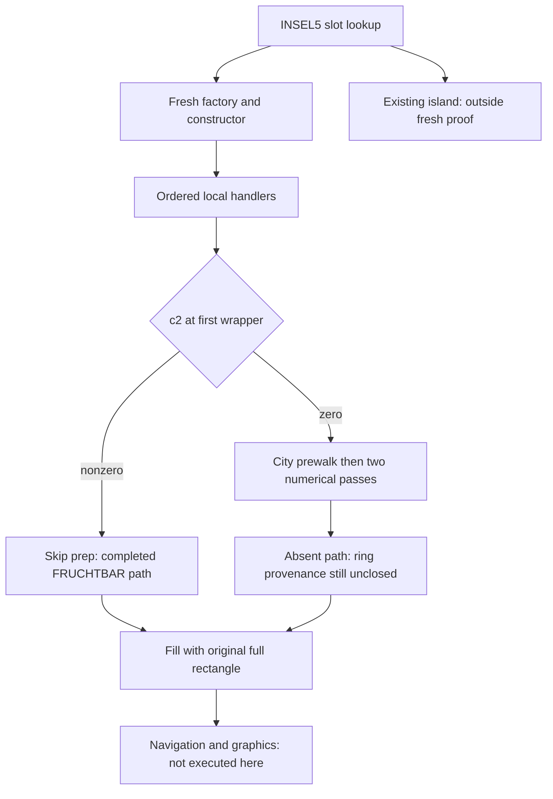

# Wildlife preparation: source and caller provenance

2026-11-19, WILDLIFE-PREP-PROVENANCE-1. D = fresh GOG instruction/table read;
P = original-file parse; H = hand derivation; C = private probe; U = unproved.
Reference AnnoWelt SHA256 and receipts: [evidence](../orchestration/evidence/wildlife-prep-provenance-1.md).
This is a partial source contract, not an implementation or World-load claim.
Read with [prefix](wildlife-prefix.md), [postload](wildlife-postload.md),
[ground preparation](wildlife-ground-prepare.md), [ground facts](wildlife-ground-facts.md),
[growth](wildlife-growth-load.md), and [preprocessing](wildlife-preprocess.md).

## 1. Actual fresh caller and source order

D: INSEL5 reader 0x100a2ea0 reads the geometry and slot prefix, narrows the
source slot at 0x100a2f38–0x100a2f4b, and looks for an existing island at
0x100a2f4b–0x100a2f5c. Only the missing-slot arm calls world +0x88 at
0x100a2f5e–0x100a2f6a. World table 0x100ccdd8 resolves this to 0x100a24d0.
The reused arm is not fresh-constructor evidence. Local records then execute
in source order through island +0xdc at 0x100a2f88–0x100a2fbc; wildlife
0x100946c0 delegates the non-HIRSCH cases to 0x10089130 at 0x10094848.
After the loop, world +0x1d4 at 0x100a2fc8 reaches 0x100a1810; navigation
and graphics follow at 0x100a2fd7/0x100a2fdf. The prefix stops before these.

D/H: 0x100a2545–0x100a2584 subtracts signed x%8 from BOTH horizontal rectangle
edges, and y%8 from BOTH vertical edges (remainder truncates toward zero).
Nonnegative source u16 coordinates therefore align the origin down to 8 while
preserving width/height. Tutorial source (24,24,128,128) yields [24,24,152,152).
Authored (7,11,3,2) yields [0,8,3,10), not [7,11,10,13). Modern raw geometry
must match this caller profile before claiming the same full-rectangle call;
do not silently patch PreparedIsland or expand an arbitrary unaligned rectangle.
The fixed alignment is original behavior, not a new population/island limit.

D: filename-null factory arm 0x100a261d–0x100a2623 calls world +0x1c4,
0x100aed70. It allocates 0xcc bytes and calls 0x10094c60 at 0x100aeda9,
then island initialization +0x180 at 0x100aedd6 (target 0x1008c090).
The original does not check this initialization return here; this contract
covers successful allocation/initialization only, not original transactional safety.

## 2. Compact provenance ledger

| Input | Original writer/reader (D) | Modern source and validation | Lifetime / positive witness / nearest wrong input |
|---|---|---|---|
| Island ordinal/slot/geometry | 0x100a2ea0–0x100a2f6a; factory alignment above | Exact immutable scene, file ordinal, parsed INSEL5 and prefix metadata; compare adjusted full rectangle | Own source through binding; Tutorial ordinal 0/slot 11; reused slot or raw unaligned geometry is outside profile |
| Final climate +0xc0 | constructor zero at 0x1008cb8e; INFO store 0x100897ee | Replay leading 12-byte INFO order, compare PreparedIsland climate; selected kernel via existing loader | Own selected kernel/growth bytes; Tutorial INFO climate 2; missing/late/mismatched INFO must not be inferred from a digest |
| Prepared marker +0xc2 | zero 0x1008cbc7; completed FRUCHTBAR sets 1 at 0x10089565; wrapper reads 0x100a1815 | Completed typed header PLUS exact raw source payload/dimensions, existing validator | Completion is evidence, not nonzero fertility; all-zero completed payload skips prep; absent/malformed is a different case |
| Raw fertility vs effective plane | nibble merge 0x1008952b–0x10089539 | Terrain raw source and effective variation compared separately | Source raw 0x20 with old effective 0xa7 gives effective 0xa0; never rewrite raw to derived plane |
| City prewalk | constructor ring zero; local STAEDTE chain below; 0x1008438f–0x100843ed reads | No sufficient general capability yet; public completion flag/modern empty vector not proof | Completed Tutorial skips this read entirely; absent path with unknown ring must refuse |
| Full two-pass geometry | wrapper prep call 0x100a1829 and fill 0x100a1834 | Same exact full adjusted rectangle, existing numerical helper/facts | Partial scratch hazards remain unsupported; full Tutorial control is matched |
| Object/growth/kernel facts | established addressed contracts linked above | Existing owned binders, exact common descriptor profile and selected source bytes | Retain owned facts, no RuntimeClass/digest substitute for concrete getter evidence |

D: INFO dispatch 0x100897a6–0x100897d8 zeroes a 12-byte local buffer then
copies payload length through 0x100b4c40. INFO[0] is loaded at 0x100897e4 and
stored at 0x100897ee. Present lengths 0–12 zero-extend safely in this body;
>12 has no destination bound and is not certified. Later INFO overwrites earlier
climate, even late in local records; it cannot retroactively change earlier
resource effects. Missing INFO leaves fresh default 0. INFO does not reset c2.

C/source: modern wildlife_prefix.cpp accepts exactly 12-byte INFO only in its
leading contiguous INFO/HEIGHT/GFXID setup, requires explicit INFO, and stops
at later unsupported setup. This is a conservative adaptation. The last leading
INFO wins, not an arbitrary last INFO extracted after prefix execution.

D: completed FRUCHTBAR sets c2 even for all-zero payload; duplicates remain
ordered. Wrapper 0x100a1810–0x100a183c calls prep +0x1a4 (0x10084370) only
when c2 is zero, then always fill +0x1a0 (0x100928a0). Modern exact-length
validation/refusal before mutation is an adaptation; malformed original I/O is
not claimed safe. Absence must never be represented as a fabricated completion.

## 3. City proof: initial zero is not final empty

D: 0x10094c60 ->0x1008f460 ->0x1008cb30 invokes 0x10096da0 on this+0x38.
0x10096da0–0x10096dac zeros sixteen dword pointers. This is an original ring
layout fact, not an engine-wide island/city cap. Initialization 0x1008c090 calls
manager constructors, then 0x100967b0 at 0x1008c2cf. That binder does not clear
the pointer ring. Reset 0x1008c740 has separate callbacks and clears c2 at
0x1008c7f1; no reset is visible in the direct local-record loop. Reuse/reset
must not inherit a fresh zero-pointer proof.

D: STAEDTE at 0x10089c45–0x10089c97 reaches ring loader 0x10096a60. Its ENTRY
arm 0x10096b37–0x10096bdb calls 0x100967e0 at 0x10096bae, constructs a city
through 0x1002f990 at 0x10096874, stores ring[index] at 0x100968a4, and calls
city +0x54 at 0x10096bd8. City creation can draw via names at 0x10096910.
After load, zero type-0x21 building count can remove/release the city through
0x10096be3–0x10096c0b. A STAEDTE header alone proves neither presence nor absence
at prep. WARETYP at 0x10096c20–0x10096d28 is a different mapping-only arm.

P: five sampled DUMMY STAEDTE payloads contain only one WARETYP (length 543),
zero ENTRY records. These are not positive witnesses for a nonempty ring.
D/U: the prewalk 0x1008438f–0x100843ed skips nulls, calls city +0x60,
index +0x24(0x21), first-building +0x0c, building +0x74 and type +0x48(0x1c).
Its eventual overwritten result does not justify erasing arbitrary getter effects.
The short city-constructor read does not establish the final dynamic city table
or all those concrete callees. Existing common object facts are not that proof.

U: no general empty-ring-at-prep domain is certified here after arbitrary
supported local handlers. Next absent-path read: close the fresh 0x1008c090
manager constructors and each admitted local callback's possible ring effects
through the first 0x100a1810 call; separately resolve the concrete ENTRY city +0x54
and getter chain before admitting nonempty rings. External player/city attachment,
filename templates, substituted receivers and reused worlds remain outside this
bounded path. None is a prerequisite for the selected completed-header path,
which never executes the prewalk.

## 4. Minimal next implementation and separate absent-path contract

Proposal, not code: a private owned composition entry takes immutable source,
PrefixInputs and existing descriptor inputs, invokes the existing prefix builder,
requires complete selected local records and matched original full geometry, then
uses prepare_wildlife_postload_fill and apply_wildlife_postload_fill unchanged.
Return the existing owned fill result. Start with the genuine completed Tutorial
control below and authored legal/refusal siblings, without World/navigation/UI
wiring. Reconstruct/check source provenance internally; accepting a caller-mutated
PreparedIsland plus its own SHA or completion Boolean is not sufficient.
This path needs no inferred city-free Boolean, numerical prep, growth/kernel
substitute, or invented absent-header prerequisite. Existing prefix stamp/mode
provenance remains explicit and unchanged; this is not original draw-history proof.

Separate future proposal: a privately constructible absent-ground capability may
only be produced after the remaining fresh-prewalk profile is proved. Internally
replay exact source selection and bind final supported INFO, selected kernel,
growth, whole-object facts, full geometry and proved ring state. Own or immutably
retain every used buffer; reject before publication and leave source/prefix,
Terrain and draw accounting unchanged. Derive an owned effective plane with the
existing numerical helper. Keep raw fertility absent and record a distinct
internal origin; never create a FRUCHTBAR header or set c2 as if one completed.
The accepted precomputed validator must continue to reject this absent input.
Only after separate review may two private validated producers share the narrow
fill body. No generic loader framework, public authenticity Boolean or new state
is proposed. Modern all-or-nothing validation is an adaptation, not original I/O.

### Hand-derived future acceptance/refusal pairs

All C++ composition checks below are **NOT_RUN**, not passing placeholders.
Private arithmetic probes exercise only the first three rules, not capabilities.

| Invariant | Legal sibling / distinguishing wrong sibling | Future proof |
|---|---|---|
| INFO selection | leading 2 then 6 ->6; reverse ->2; stale 6 against reverse refuses | Exact replay and selected kernel; missing or late INFO conservatively refuses |
| Completion | completed four zeros skips prep; absent enters separate path; three bytes for four cells refuses | Preserve raw absence and old precomputed validator |
| Effective/raw | raw 0x20 plus old 0xa7 ->effective 0xa0, raw stays 0x20 | Whole plane and source equality |
| Identity/geometry | Tutorial ordinal 0/slot 11/full [24,24,152,152); wrong ordinal/slot/rect or tampered prefix refuses | Match raw records and factory adjustment, not hash alone |
| City profile | selected completed header requires no prewalk claim; absent with future proved empty profile vs unknown/nonempty refuses | No fabricated no-city flag; explicit proof boundary |
| Full call | exact full rectangle vs clipped/partial rectangle refuses for prep composition | Both passes use same full bounds |
| Lifetime/atomicity | destroy input owners after binding; mutate unrelated caller copies | Stable owned output; refusal publishes nothing and changes no draw count |

## 5. Bounded shipped-source result

P: frozen sample: selected Tutorial + first twelve lexical SCP templates + first
lexical template in each other climate folder + first lexical DUMMY per folder
(or first unselected lexical file where no DUMMY exists). 24 files/24 islands:
24 completed FRUCHTBAR, 0 absent, 0 all-zero; 24 complete nonoverlapping HEIGHT/GFX
layouts, one INFO each. This is a sample-only result, not a corpus absence claim.
The preserved first-selection script establishes the missing-Tundra-DUMMY
selection path before payload reads. Its stdout logs are empty; the first runtime
diagnostic and exit status are unavailable, not retained evidence. The corrected
fallback is explicit. No header was removed or source modified.

P: Scenes/Tutorial/01Discover01.sze SHA256
`225ed50b005743e00d8d3ffe18667d4565dc781ef45bd6d9b767fd2fe056c0f6`:
ordinal 0, slot 11, 73 local headers; INFO header 0/payload offset 1943,
length 12/climate 2; FRUCHTBAR header 49/payload offset 80739/length 16384.
Low-plane SHA256 `02c939bcca166d877f5656556510d88afbeea6fd6bff31eba348c40bcd598334`.
This genuine completion skips prep. No sampled shipped absent-ground witness
was found; a synthetic absent sibling cannot be presented as one.
